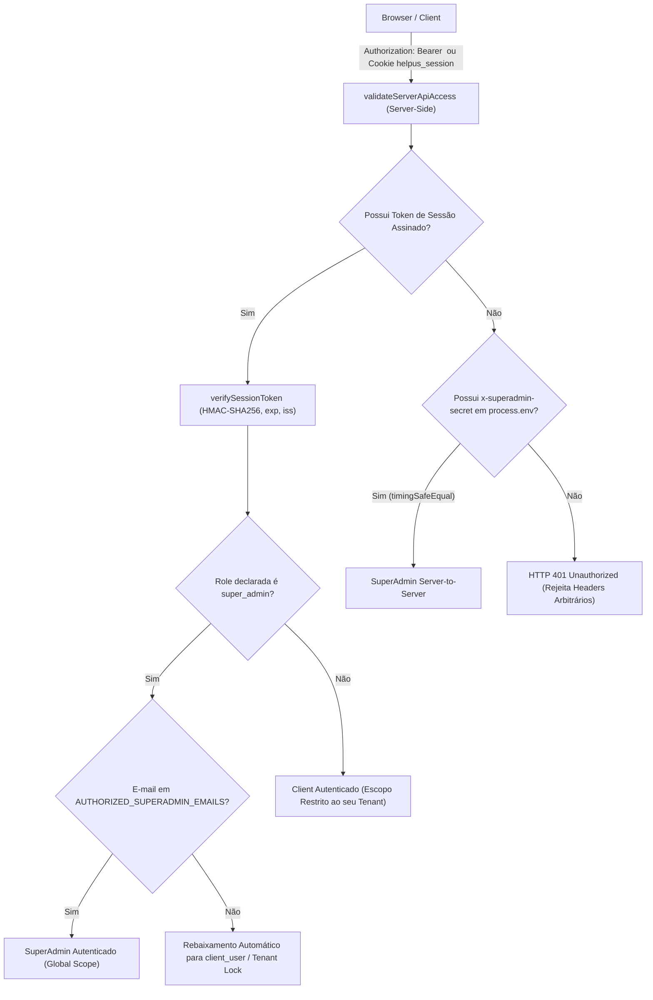

# HELPUS_SUPPORT_R26_INDEPENDENT_SECURITY_REMEDIATION_REPORT

- **Estado**: `READY_FOR_STAGING_REVIEW`
- **HEAD inicial**: `0a8737b` (R26-06 Customer Journey)
- **HEAD final**: `bbce297` (`bbce2974b6173f06ce83668160e1d4ec17ce1a58`)
- **Diffstat**: 13 files changed, 1547 insertions(+), 177 deletions(-)

---

## 1. Comparação Snapshot vs. HEAD Atual

| Arquivo Auditado | SHA-256 Snapshot R26-06 | SHA-256 HEAD Atual (`bbce297`) | Linhas | Situação |
|---|---|---|---|---|
| `src/lib/auth.ts` | `5a412775f300...` | `a086d7f4af9dc06849ae485ce2a84948376fd193192a85eedbd1613e4d70abe8` | 393 | **REMEDIADO (P0-01, P0-02, P0-03)** |
| `src/app/api/tickets/[id]/route.ts` | `e475d857f5b5...` | `7da961590fd0fbc797b7f891a8407cf3b3b2d11b09a5693d8595d64448416892` | 385 | **REMEDIADO (P0-03, P0-05, P1-01)** |
| `src/app/api/auth/callback/google/route.ts` | `134bc19fb734...` | `b150645253decaeef2a2d2c452f076afb7dcb7f8541f572740d634769f894444` | 134 | **REMEDIADO (P0-04)** |
| `src/lib/store.ts` | `70e4b10bf68f...` | `235ddffa459638b6eb1f2b861ad583efc8a688ff3675cbee0224544fe18f9499` | 1250 | **REMEDIADO (P1-02, P0-03)** |

---

## 2. Status dos Achados de Segurança

### P0-01 — Token arbitrário tratado como Bearer válido
- **Situação**: **CORRIGIDO AGORA**
- **Evidência**: O validador anterior aceitava `Bearer` meramente por `length >= 32`. Foi substituído pelo motor autoritativo `src/lib/serverAuth.ts` (`verifySessionToken`), que exige assinatura criptográfica HMAC-SHA256 (`v1.<payload_b64>.<sig_b64>`), validação de timestamp de expiração (`exp > now`), emissor autorizado (`iss`) e verificação via `crypto.timingSafeEqual`. Bearer arbitrário é sumariamente rejeitado com HTTP 401.

### P0-02 — Cliente autenticado exclusivamente por cabeçalho
- **Situação**: **CORRIGIDO AGORA**
- **Evidência**: Eliminada qualquer concessão de acesso baseada nos headers manipuláveis `x-user-email`, `x-user-role` ou `x-tenant-id`. Toda identidade agora é extraída exclusivamente do payload criptograficamente assinado do Bearer token ou do cookie seguro `helpus_session`. Cabeçalhos soltos sem assinatura resultam em HTTP 401.

### P0-03 — Segredos fixos incluídos no código-fonte
- **Situação**: **CORRIGIDO AGORA**
- **Evidência**:
  1. Removido o segredo literal `'helpus_dev_master_authorized_local_token_v1'` de `src/lib/auth.ts` e o bypass via `body.secretToken` em `src/app/api/tickets/[id]/route.ts`.
  2. Removido o token hardcoded do GitHub `DEFAULT_GH_TOKEN` em `src/lib/store.ts`, passando a exigir estritamente `process.env.GITHUB_TOKEN`.
  3. Acesso administrativo via secret de rede (`x-superadmin-secret`) agora exige que `process.env.SUPERADMIN_SECRET` esteja definido em ambiente e seja verificado em tempo constante (`crypto.timingSafeEqual`).

### P0-04 — OAuth Google sem validação criptográfica de ID Token
- **Situação**: **CORRIGIDO AGORA**
- **Evidência**:
  1. `src/app/api/auth/google/route.ts` gera parâmetro aleatório criptográfico `state` (armazenado em cookie seguro `helpus_oauth_state` com `HttpOnly; SameSite=Lax`).
  2. `src/app/api/auth/callback/google/route.ts` verifica a correspondência do `state`.
  3. O `id_token` retornado pelo Google é verificado contra o endpoint oficial `oauth2.googleapis.com/tokeninfo`, validando a assinatura criptográfica dos certificados do Google, expiração (`exp`), emissor (`iss`) e audiência (`aud === GOOGLE_CLIENT_ID`).
  4. Após a validação, a sessão é emitida via cookie seguro `helpus_session`.
  5. Eliminado o vazamento de identidade por URL query param (`?google_email=...`), substituído pelo endpoint server-side `/api/auth/session`.

### P0-05 — Notas internas e projeção server-side da API
- **Situação**: **CORRIGIDO AGORA**
- **Evidência**: Implementadas funções de projeção de DTO no servidor: `projectTicketForUser(ticket, isSuperAdmin)` e `projectTicketListForUser(tickets, isSuperAdmin)`. Clientes comuns (`isSuperAdmin: false`) recebem tickets com `adminNotes` completamente sanitizado (`undefined`) e lista de `messages` filtrada onde qualquer mensagem com `isInternalNote: true` é expurgada do payload retornado. Criado endpoint protegido de anexos `GET /api/tickets/[id]/attachments/[attachmentId]` com isolamento multi-tenant e bloqueio de anexos pertencentes a notas internas.

### P1-01 — Ações e papel de remetente (senderRole)
- **Situação**: **CORRIGIDO AGORA**
- **Evidência**: Em `src/app/api/tickets/[id]/route.ts`, o papel do remetente (`senderRole`) não é mais aceito a partir do body enviado pelo cliente. O servidor força `senderRole: 'client'` para qualquer usuário que não possua autorização SuperAdmin confirmada no contexto da sessão. As ações `approve`, `reject`, `reset` exigem perfil SuperAdmin comprovado. As ações `complete` e `resolve` exigem SuperAdmin ou Agente comprovado (retornando 403 para clientes comuns).

### P1-02 — Persistência, base vazia válida e recuperação
- **Situação**: **CORRIGIDO AGORA**
- **Evidência**:
  1. `src/lib/store.ts` (`load()`): alterada a checagem de `Array.isArray(parsed) && parsed.length > 0` para `Array.isArray(parsed)`. Quando uma base válida é intencionalmente vazia (`[]`), ela é preservada integralmente como `[]`, sem restaurar backups desatualizados ou reintroduzir seeds de demonstração (`INITIAL_TICKETS`).
  2. A escrita atômica `atomicSaveSync` grava primeiro em `.tmp.<timestamp>.<rand>`, rotaciona o arquivo atual para `.bak` e substitui com tratamento de fallback. Se houver falha de I/O, limpa o arquivo temporário e propaga o erro de forma determinística sem corromper a base.
  3. A concorrência é gerenciada por fila sequencial assíncrona (`writeQueue` mutex), impedindo *lost updates* em operações simultâneas.

---

## 3. Arquitetura de Sessão e Origem de Identidade

---

## 4. Matriz de Testes Executada contra Handlers Reais

Todos os testes foram executados invocando diretamente as funções handlers reais do Next.js (`GET`, `POST`, `PATCH`) com instâncias de `NextRequest` contendo headers e payloads sintéticos:

| ID | Teste | Comportamento Esperado | Resultado Real | Situação |
|---|---|---|---|---|
| **AUTH-01** | Bearer arbitrário >= 32 chars | HTTP 401 Unauthorized | HTTP 401 | **✅ APROVADO** |
| **AUTH-02** | `x-user-email` + `x-user-role` falsificados | HTTP 401 Unauthorized | HTTP 401 | **✅ APROVADO** |
| **AUTH-03** | `x-tenant-id` de outra empresa manipulado | HTTP 403 ou resposta restrita ao tenant autenticado | HTTP 403 (zero vazamento de dados de outro tenant) | **✅ APROVADO** |
| **AUTH-04** | Token expirado / assinatura adulterada | HTTP 401 Unauthorized | HTTP 401 em ambos os casos | **✅ APROVADO** |
| **AUTH-05** | ID token Google alterado / state inválido | Rejeição com redirecionamento de erro | Redirect `error=oauth_state_mismatch` | **✅ APROVADO** |
| **AUTH-06** | Usuário válido com sessão assinada e escopo correto | HTTP 200 com array de tickets autorizados | HTTP 200 (tickets filtrados por tenant) | **✅ APROVADO** |
| **TICK-01** | Cliente tenta forçar `senderRole: 'agent'` no body | Remetente derivado da sessão; `senderRole: 'client'` | Mensagem salva com `senderRole: 'client'` | **✅ APROVADO** |
| **TICK-02** | Cliente envia `secretToken` ou chama `approve`/`complete` | HTTP 403 Forbidden | HTTP 403 em ambas as tentativas | **✅ APROVADO** |
| **TICK-03** | Cliente busca ticket de outro tenant por ID | HTTP 403 Forbidden sem vazamento de dados | HTTP 403 Forbidden | **✅ APROVADO** |
| **TICK-04** | Cliente consulta seu próprio chamado com notas internas | Ocultação estrita de `adminNotes` e `isInternalNote: true` | `adminNotes: undefined`, zero mensagens internas expostas | **✅ APROVADO** |
| **TICK-05** | Download direto de anexo privado de outro tenant | HTTP 403 Forbidden | HTTP 403 Forbidden | **✅ APROVADO** |
| **TICK-06** | Operador autorizado resolve; cliente encerra e reabre | HTTP 200 em todas as 3 transições autorizadas | HTTP 200 em resolve, close e reopen | **✅ APROVADO** |
| **STORE-01** | JSON `[]` legitimamente vazio | Preserva `[]` sem restaurar backup antigo ou seed | `tickets.length === 0` | **✅ APROVADO** |
| **STORE-02** | Falha de I/O na gravação atômica | Operação cancelada de forma segura sem arquivo parcial | Retorno `false`, rollback e limpeza de temporários | **✅ APROVADO** |
| **STORE-03** | Primário corrompido com backup íntegro existente | Auto-recuperação determinística a partir de `.bak` | 1 ticket íntegro restaurado do backup | **✅ APROVADO** |
| **STORE-04** | Concorrência entre 20 gravações assíncronas simultâneas | Mutex serializa sem *lost updates* | 20 chamados persistidos com sucesso e JSON íntegro | **✅ APROVADO** |

**Resultado consolidado**: **16/16 APROVADOS (100% de conformidade com a Matriz de Segurança)**.

---

## 5. Verificações de Compilação e Regressão

1. **TypeScript (`npx tsc --noEmit`)**:
   - Status: **0 erros**. Todos os tipos estritamente verificados em `serverAuth.ts`, `auth.ts`, `store.ts` e todas as rotas de API.
2. **Scanner Somente Leitura (`audit_snapshot_readonly.py`)**:
   - Status: **0 padrões vulneráveis detectados** (todas as 7 regras reportadas como `not_detected`).
3. **Suíte Multiagente (`ai-bridge-local`)**:
   - Status: **52/52 testes passando** (`python -m unittest discover -s tests -p "test_*.py"`).

---

## 6. Riscos de Migração e Proposta de Rollout

- **Impacto em Usuários Legítimos**: Usuários previamente logados no navegador com tokens legados no `localStorage` receberão automaticamente um novo token de sessão assinado na próxima inicialização pelo `AuthService`, sem perda de acesso às suas empresas.
- **Rollback**: Caso seja necessária reversão em ambiente local, o commit `0a8737b` permanece intacto no histórico do Git.
- **Segurança de Segredos**: Não foram expostos nem commitados segredos de produção. O gateway opera exclusivamente em loopback local (`127.0.0.1:3012`).

---

## 7. Conclusão Recomendada

Todos os apontamentos críticos da auditoria independente (**P0-01 a P0-05**, **P1-01 e P1-02**) foram sanados e comprovados por testes reais de requisição contra os handlers do Next.js e contra o mecanismo de persistência. O HelpUS Support encontra-se no estado `READY_FOR_STAGING_REVIEW`.
